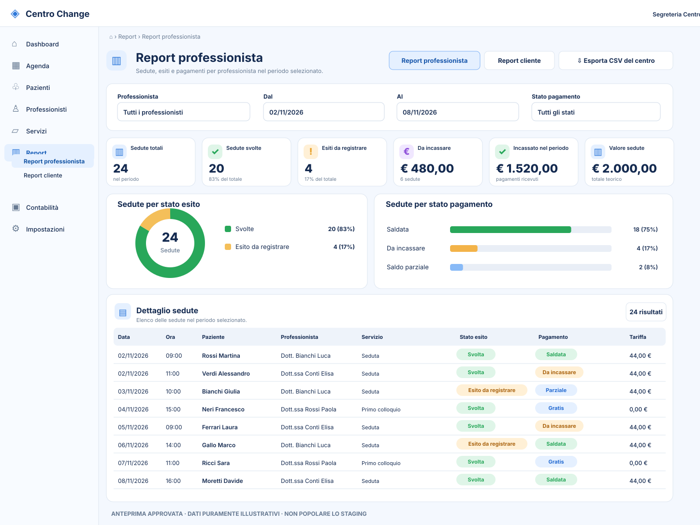
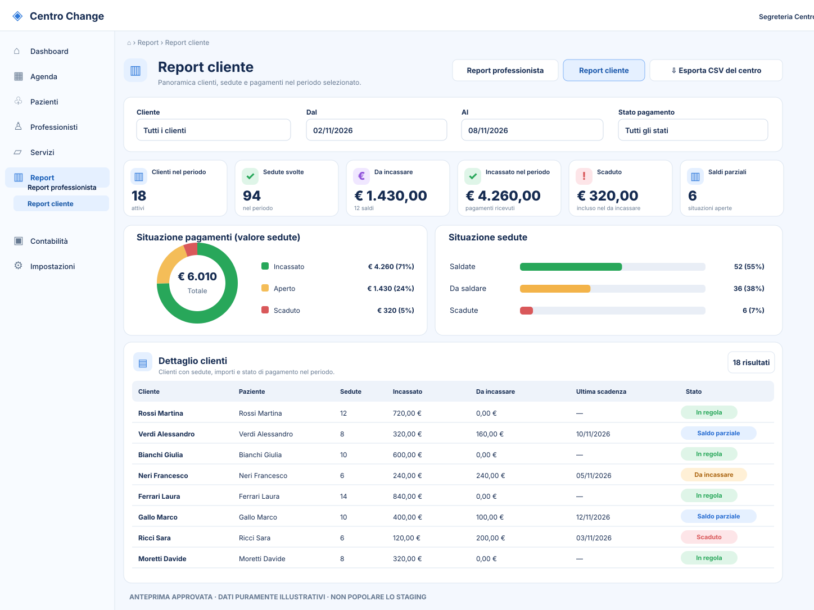

# Centro Change — Report UX approvati dall'Owner (06/11/2026)

## Anteprime visuali accessibili da GitHub

Le seguenti due immagini **SVG** sono ricostruzioni vettoriali del layout approvato dall'Owner in chat, per consentire a Codex di visualizzare direttamente griglia, navigazione, KPI, filtri, grafici, tabelle, spaziature e priorità informative. **Non sono i PNG originali generati in chat**, e non vanno scambiate per screenshot della versione installata.

### 1. Report professionista

[Apri l'immagine SVG del Report professionista](./report-professionista.svg)

### 2. Report cliente

[Apri l'immagine SVG del Report cliente](./report-cliente.svg)

## Decisioni funzionali vincolanti

- Nella sezione Report devono apparire **soltanto due viste principali**: **Report professionista** e **Report cliente**. Eliminare da questa pagina il pulsante «Compensi e fatture autorizzati», senza rimuovere funzioni contabili esistenti.
- Filtri per persona, intervallo date e stato pagamento; KPI, grafici e tabelle devono aggiornarsi coerentemente, con dati ottenuti dalle API e non inventati.
- Report professionista: sedute totali, svolte, esiti da registrare, incassato, da incassare, valore teorico; dettagli per appuntamento con stato esito **separato** da stato del pagamento.
- Report cliente: cliente fiscale (Customer), che può essere responsabile di **più pazienti**; sedute, incassato, da incassare, scaduto (sottoinsieme del da incassare, non somma aggiuntiva), status e dettagli.
- Colloquio gratuito 20 minuti = **0 € e nessun debito**. Seduta ordinaria = 45 minuti a **44 €**. I nomi, gli importi e i conteggi rappresentati nei due SVG sono **solo segnaposto illustrativi della UX**.
- **STAGING deve restare vuoto** fino al futuro popolamento demo espressamente richiesto dall'Owner. KPI zero e stati vuoti sono corretti; vietato creare dati fittizi per far assomigliare il browser alle immagini.
- Manager / segreteria Full Permission; professionisti e commercialista solo nelle rispettive autorizzazioni; Guest non accede.
- Uso di spaziature coerenti, responsive desktop/tablet/mobile, etichette leggibili, nessun doppio scroll o sovrapposizione. Esportazione CSV coerente con la vista corrente e i permessi.

**Decisione originale nel tracker:** [#156 — approvazione Owner delle dashboard](https://github.com/2008hitch-afk/centrochange_core/issues/156#issuecomment-6690760200).

**Questi file sono riferimenti visivi e documentazione. Non costituiscono implementazione, merge o deploy.**
